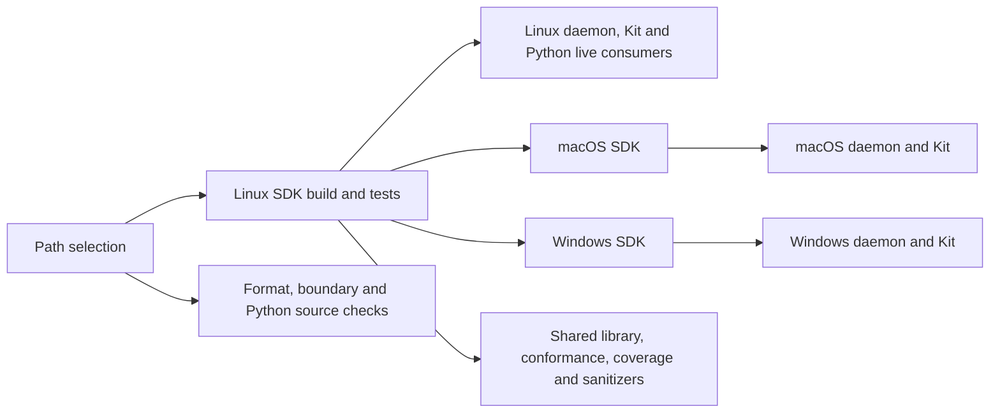

# Shared SDK CI

Automatic PR/main CI is `.github/workflows/shared-ci.yml`. It builds each selected
RelWithDebInfo host SDK once. Each consumer depends on its platform's producer,
not the slowest platform. Android continues its independent NDK/source build.



The Linux gate uses the normal SDK build, CTest and packaging smoke test. It
restores only SDKs already tested for the same core tree, root version and build
configuration. Coverage, sanitizers, shared-library conformance, Ubuntu packages
and the Windows Debug tests retain their separate build requirements. Once the
gate passes they run alongside other platform work. SDK matrices use
`fail-fast: false`; a platform failure leaves independent diagnostics running.
A failed gate prevents dependent builds and platform runner requests. Each
selected suite's required result fails if a required SDK/consumer failed or was
cancelled/skipped. Unselected suites still report a passing required result.

`core-selection-<platform>` describes that platform's artifact and records the
calling commit/tree plus each archive's original producer commit, configuration,
size and SHA-256. The fetch action checks the selected tree against checkout and
retains its commit, checksum and manifest checks. These immutable run artifacts
are the consumer handoff; concurrent caches are not used for synchronization.
The aggregate `core-selection` remains available to main's SDK publication and
standalone Release tooling. Producer calls use unique aggregate index names.

The four standalone suite workflows retain their manual entry points, including
Daemon's Release/configuration inputs and backend provenance. Their job recipes
also supply the automatic workflow. To change a job, edit its standalone source
(`core-ci.yml`, `daemon-ci.yml`, `kit-ci.yml`, `python-check.yml`) and regenerate:

```sh
python3 -m pip install 'PyYAML==6.0.3'
python3 .github/scripts/generate-shared-ci.py
python3 .github/scripts/generate-shared-ci.py --check
python3 -m unittest discover -s .github/scripts/tests -v
```

Repository / Checks rejects stale generated YAML. The generator namespaces job
IDs and dependencies, adds shared producers, and preserves the exact top-level
Core CI result, Daemon CI result, Kit CI result and Python check result names.
The other four required checks remain in their existing workflows. Independent
manual cache measurement and Release SDK/promotion paths remain standalone.
Development staging searches Shared / CI; Release staging still searches Daemon
/ CI. Both retain exact backend/SDK provenance verification.

PR path selection uses the merge commit's base/head parents. Main uses the push's
`before..HEAD` range, preserving useful selection across multi-commit pushes.
Manual dispatch selects all jobs. Changes to the graph or its source workflows
exercise all four suites. PR label changes still update package-skip decisions.

A newer run for the same PR cancels the entire old graph; platform jobs never
cancel their siblings. Main and manual runs use distinct concurrency groups so
publication is not interrupted by a newer commit. Existing publication locks
remain unchanged.

Validation uses the actual selection/result shell scripts for relevant/unrelated
paths, push/PR/manual events, failures, cancellation and labelled package skips,
plus graph checks for one producer per platform, dependencies, check names and
manual Release inputs. SDK and staging provenance tests cover mismatched
commits/configurations, modified archives and cached SDK producer commits.
Live timings should record gate duration, consumer start time, overall feedback
and summed job durations separately for changed-core, unchanged-core and failing
core candidates. Cached gate timings are not cold build savings estimates.
