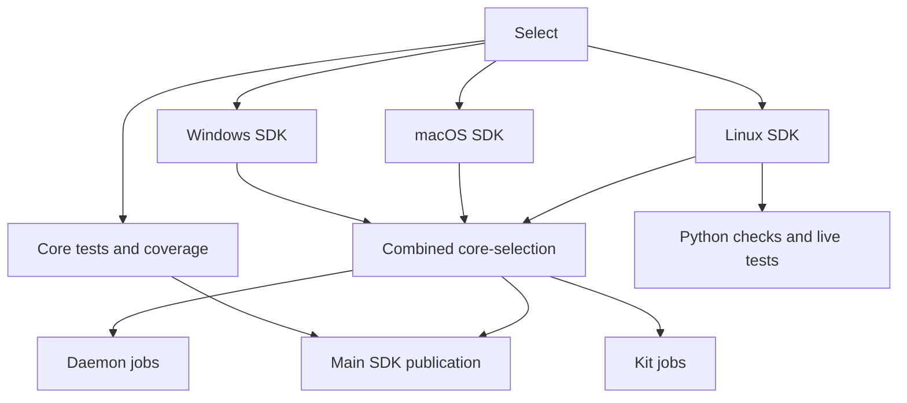

# Shared SDK CI

`daemon-ci.yml` is the automatic entrypoint for Core, Daemon, Kit and Python.
Its filename remains the backend run identity used by staging and SDK promotion.
The desktop, Android, API-contract and website workflows remain independent.

The selector keeps the previous component path rules, including the daemon's
C-API/test exclusions. Python-only changes request only Linux. Core tests do not
wait for SDKs; Python does not wait for SDK platforms it cannot use. Daemon and
Kit retain their existing all-platform SDK gate. SDK platforms run in parallel
without cancelling one another on failure, preserving useful diagnostics.

Only the three SDK producer jobs compile/package host SDKs. Their selection
artifacts are named by platform and build type, and each indexes only its own
platform's archives. A combined `core-selection` is uploaded once for Daemon,
Kit, staging and promotion. Consumers check the run commit, core tree and required
configurations before using the normal archive checksum/manifest validation.
A consumer's SDK job verifies existing artifacts; it cannot fall back to another
build. Finished-SDK and compiler-cache reuse remain in the producer.

If an SDK platform fails, its dependent consumers do not start. The canonical
Core CI result reports the originating failure; blocked consumer result jobs
are skipped. Python can still finish when its Linux prerequisite passed and an
unrelated platform failed. Test/coverage failures remain visible in Core CI
without imposing a serial platform canary on the other configurations.

Top-level result jobs retain `Core CI result`, `Daemon CI result`, `Kit CI result`
and `Python check result`. Reusable workflow jobs may have prefixed diagnostic
names, but these four canonical checks have no prefix. The other four required
checks keep their existing workflows and names.

## Manual and release entrypoints

- `daemon-ci.yml`: `scope=daemon` (the default), with the original
  `core_build_type` and `core_packages` inputs. Release artifacts and their
  combined core-selection remain in that exact run, so staging and SDK promotion
  need no workflow-name exception. Release is limited to this manual scope.
- `core-ci.yml`: standalone core tests, SDKs and optional compiler-cache measurements.
- `kit-ci.yml` and `python-check.yml`: standalone checks with their own SDK producer.
- `release-kit-pypi.yml` keeps its existing SDK/release configurations.

The shared entrypoint also accepts `scope=all`, `core`, `kit`, `python`, `none`
or `changed` for validation. None of its manual modes publishes SDK releases;
the existing publication jobs still require a push to main and their environment.
Ubuntu package builds remain distribution-specific builds, not host SDK users.
They keep their existing artifacts and now wait for the SDK prerequisite before
starting dependent consumer package work. Android keeps its independent NDK/source
build and has no host-SDK dependency.

## Validation before switching automatic triggers

Keep the legacy automatic triggers during preview. Validate the shared entrypoint
on implementation/probe branches: core-changing success, a core compile failure,
an unchanged-core daemon-only change, no selected consumers, and a standalone
manual Release daemon run. Check canonical result names, artifact uniqueness,
source/configuration rejection tests and consumer skipping on failure. Then move
the four automatic scopes to the shared entrypoint; leave standalone dispatches.
